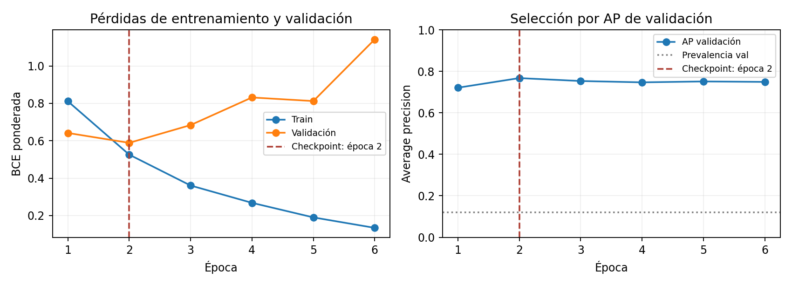
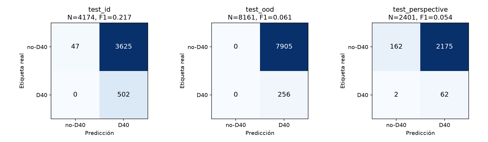
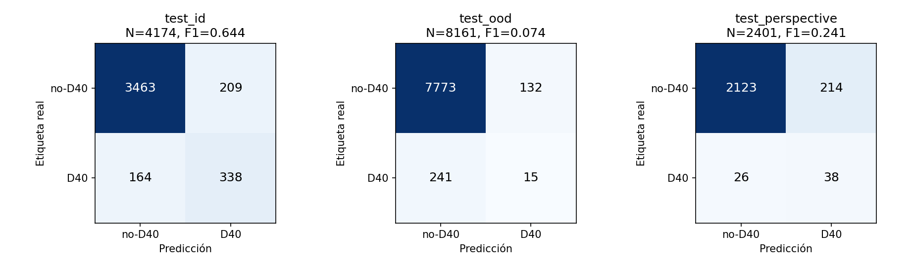
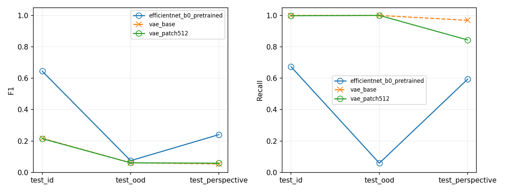
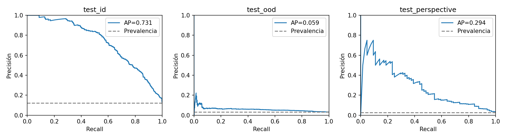
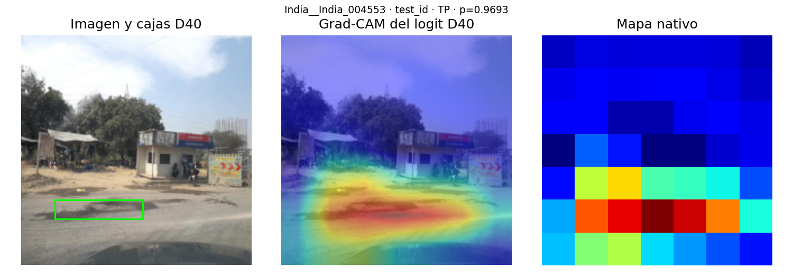
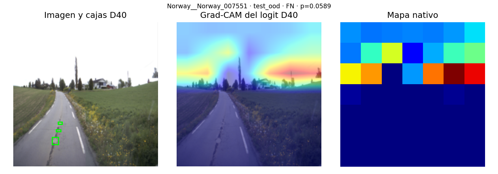
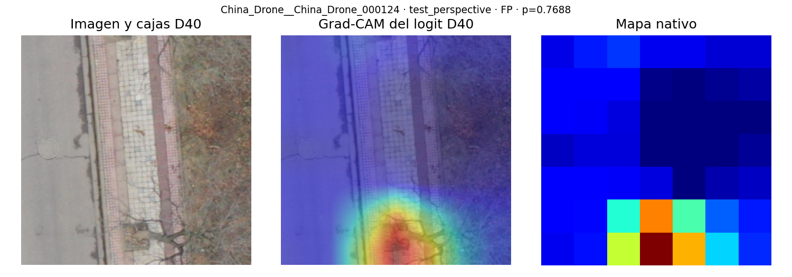
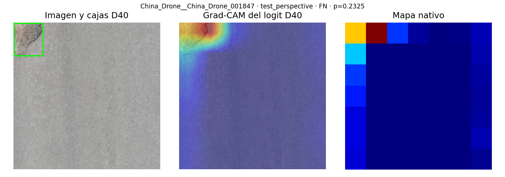

# Clasificación de baches y generalización entre dominios

**Universidad del Valle de Guatemala · Facultad de Ingeniería**

CC3092 — Deep Learning y Sistemas Inteligentes · Ing. Luis Alberto Suriano

**Proyecto final: RDD2022, ResNet18, VAE, EfficientNet-B0 y Grad-CAM**

Vianka Vanessa Castro Ordoñez — 23201

Ricardo Arturo Godínez Sánchez — 23247

Diego Javier López Reinoso — 23747

Jorge Luis Felipe Aguilar Portillo — 23195

**Informe técnico de avance para revisión del equipo**

Corte: 31 de octubre de 2026, America/Guatemala.

Redacción e integración de la contribución de Felipe: XAI, evaluación cross-domain y extensión EfficientNet-B0. Se reconocen los datos y resultados previos de los demás integrantes. El contenido debe revisarse colectivamente antes de su entrega académica.

**Estado de la evidencia:** EfficientNet-B0 ya fue entrenada con RDD2022 local verificado, evaluada en los tres tests y contrastada con los resultados VAE archivados. Se generaron e inspeccionaron 36 mapas Grad-CAM reales y se midió latencia CPU/MPS. B0 alcanza F1 0.6444 en el test interno, pero omite 241 de 256 baches en Noruega. Faltan resultados verificables de ResNet para compararla y una evaluación de Guatemala; no se recomienda despliegue.

Repositorio del equipo: https://github.com/Vann06/Pothole-Detection-Guatemala

La estructura sigue las ocho secciones de documentación de `Proyecto Final.pdf`. Se añade una matriz de cumplimiento y una guía breve de defensa. No se modificó el documento compartido de OneDrive ni la copia original `Proyecto Final - Baches.docx`.

<!-- pagebreak -->

## 1. Descripción del problema

La inspección de daño vial mediante imágenes puede apoyar la priorización de revisiones de carreteras. El problema no se reduce a obtener una clasificación correcta dentro del dataset: un sistema entrenado con otros países puede cambiar de comportamiento al variar pavimento, iluminación, cámara, perspectiva o contexto. El interés aplicado del proyecto es estudiar esa limitación antes de proponer su uso en calles de Guatemala. No se estiman costos ni cifras de infraestructura nacional sin fuentes verificadas.

Se formula una tarea binaria a nivel de imagen: **D40 positivo si existe al menos un bache anotado; negativo si no existe una anotación D40**. Un negativo puede contener grietas u otros daños. Ninguno de los clasificadores entrega cajas delimitadoras; Grad-CAM tampoco convierte la solución en un detector de objetos ni en un segmentador.

**Pregunta principal:** ¿qué capacidad de discriminación y generalización ofrecen los enfoques supervisados y de reconstrucción al evaluar datos internos, un país no visto y, posteriormente, fotografías revisadas de Guatemala?

Los objetivos son comparar inicialización aleatoria y transfer learning en ResNet18; estudiar las limitaciones del VAE; añadir un comparador supervisado EfficientNet-B0; cuantificar el cambio entre dominios; interpretar errores con Grad-CAM; y medir costo de inferencia bajo condiciones comparables. Los objetivos aún no medidos se mantienen como preguntas abiertas.

## 2. Análisis

### 2.1 Datos y unidad experimental

RDD2022 contiene 47,420 imágenes de seis países según su publicación [1]. La versión etiquetada utilizada por el equipo, `dataset_v1`, contiene **38,385 imágenes y 65,712 objetos anotados**. No se utilizan las 9,035 imágenes del test original sin etiquetas de esta copia. China tiene dos dominios de adquisición: motocicleta y dron; siete dominios no equivalen a siete países.

Fuente de las siguientes tablas: `data/manifests/images.csv`, unido uno a uno con `splits.csv`. Las cifras se recalcularon en esta revisión.

| Dominio | Imágenes | D40 + | Sin D40 | D40 % |
|---|---:|---:|---:|---:|
| China_Drone | 2401 | 64 | 2337 | 2.67 |
| China_MotorBike | 1977 | 164 | 1813 | 8.30 |
| Czech | 2829 | 154 | 2675 | 5.44 |
| India | 7706 | 1530 | 6176 | 19.85 |
| Japan | 10506 | 1390 | 9116 | 13.23 |
| Norway | 8161 | 256 | 7905 | 3.14 |
| United_States | 4805 | 116 | 4689 | 2.41 |
| Total | 38385 | 3674 | 34711 | 9.57 |

### 2.2 Particiones y prevención de fuga de información

Norway completo se reserva como `test_ood`: tiene positivos y negativos suficientes para estudiar daño y no daño, mientras India y Japan aportan más positivos al entrenamiento. No se seleccionó por el desempeño de un modelo ni por similitud demostrada con Guatemala. China_Drone se reserva íntegramente como `test_perspective` para distinguir cambio de perspectiva de cambio geográfico.

| Partición | Imágenes | D40 + | Sin D40 | D40 % |
|---|---:|---:|---:|---:|
| Train | 19476 | 2348 | 17128 | 12.06 |
| Validación | 4173 | 504 | 3669 | 12.08 |
| Test interno | 4174 | 502 | 3672 | 12.03 |
| Noruega OOD | 8161 | 256 | 7905 | 3.14 |
| China_Drone | 2401 | 64 | 2337 | 2.67 |

Los dominios restantes se dividieron aproximadamente 70/15/15, estratificando por país y estado del daño, con seed 42 y agrupación de duplicados binarios. Se conserva el mismo manifest para todos los modelos. El SHA256 de `splits.csv` es:

```text
c7b4690943e597a382ab0f7a8ad1298317f267901476b72111a1b1a8041a8614
```

No se balancean validación ni test. El peso positivo de la pérdida supervisada se calcula solo con train: 17128 / 2348 = 7.2947. No disponer de identificadores fiables de secuencia o tramo impide garantizar independencia visual entre imágenes cercanas; eliminar duplicados exactos no resuelve esa limitación.

### 2.3 Datos locales verificados y alcance de Guatemala

Felipe descargó los datos en `data/raw/RDD2022/`. La comprobación local verificó **las 38,385 imágenes y sus 38,385 XML contra los SHA256 de `dataset_v1`**, además de los hashes, etiquetas, cobertura de dominios y separación de duplicados del contrato congelado. No faltan imágenes ni es necesario conectarse a OneDrive para entrenar o evaluar esta copia.

Se ejecutaron `python3 src/data/make_splits.py --check` y `python3 src/data/share_dataset.py --verify`, sin regenerar manifests ni particiones. La verificación compara los archivos extraídos con el inventario original; no presupone haber inspeccionado la carpeta remota ni haber verificado los contenedores ZIP. Las imágenes y los pesos permanecen fuera de Git.

Guatemala necesita un manifest externo con etiquetas revisadas, procedencia, cámara, iluminación, clima y sesión/tramo. No hay un conjunto disponible y verificado en esta revisión; por tanto, su tamaño y métricas son **no disponibles**, no cero. Deben anonimizarse rostros y placas y respetarse permisos/licencias. Guatemala no participa en entrenamiento, selección de hiperparámetros ni elección del umbral del experimento principal.

## 3. Propuesta de solución

### 3.1 Enfoques y evolución de la idea

La propuesta original contrasta clasificación supervisada con detección de anomalías por reconstrucción. El trabajo del equipo implementó ResNet18 y un VAE convolucional; Diego extendió este último a parches y normalización por posición. Felipe añadió evaluación reproducible y Grad-CAM, y posteriormente la extensión EfficientNet-B0.

| Enfoque | Pregunta que responde | Estado verificable |
|---|---|---|
| ResNet18 scratch / preentrenada | ¿Aporta valor transfer learning? | Código y configuraciones; resultados no disponibles aquí. |
| ResNet18 con augmentation | ¿Cambiar apariencias mejora generalización? | Código; comparación controlada y resultados pendientes. |
| VAE base / parches | ¿El error de reconstrucción discrimina D40? | Dos experimentos reales archivados; resultado negativo bajo el protocolo. |
| EfficientNet-B0 preentrenada | ¿Otra arquitectura supervisada mejora el compromiso calidad/costo? | Entrenada y evaluada: mejora frente al VAE en test interno y dron; falla gravemente en recall de Noruega. |
| Grad-CAM | ¿Qué regiones se asocian al logit D40? | 36 mapas reales generados e inspeccionados; hay aciertos y errores con activación fuera de D40. |

### 3.2 Por qué añadir EfficientNet-B0

La reconstrucción y la clasificación optimizan objetivos distintos. Un VAE puede reconstruir adecuadamente un bache o responder a texturas no relacionadas con D40. En validación, los scores disponibles del VAE no superan la referencia de prevalencia; elevar la resolución y normalizar por posición no cambió ese resultado. La alternativa supervisada utiliza explícitamente las etiquetas D40, por lo que su función de pérdida se alinea con la pregunta principal.

Se eligió EfficientNet-B0 [4] como comparador de ResNet18: ambas son CNN, tienen pesos ImageNet y pueden usar exactamente la misma salida binaria, splits, preprocesamiento y evaluación. La cabeza binaria implementada deja **4,008,829 parámetros en B0 frente a 11,177,025 en ResNet18**, contados directamente en los modelos. Menos parámetros no garantiza menor latencia; esta debe medirse en el hardware real.

La pregunta adicional no es «encontrar un algoritmo que obligatoriamente gane», sino medir si cambia la discriminación, el deterioro externo y el costo. También sería informativo que B0 no supere a ResNet. No se borra el resultado VAE ni se redefine retrospectivamente el éxito para ocultarlo.

Se consideró que un detector de objetos como YOLO cambiaría la salida, las métricas y el alcance experimental; no es un reemplazo directamente comparable de clasificación binaria. Continuar con más variantes VAE sería posible, pero las dos ampliaciones ya evaluadas justifican explorar un objetivo supervisado antes de ampliar esa búsqueda. B0 es una elección experimental razonable, no una superioridad demostrada.

### 3.3 Riesgo de adaptación al test

La nueva propuesta surgió después de conocer resultados del VAE, incluidos tests externos. Por ello, no sería correcto describir toda la investigación como preregistrada o completamente independiente del test. Para limitar la adaptación, se fija ahora una configuración B0 comparable con ResNet y se prohíbe ajustarla a partir de Noruega o China_Drone. Si posteriormente se prueban numerosas alternativas tras observar esos tests, hará falta una evaluación confirmatoria realmente nueva. Guatemala puede cumplir ese papel solo si permanece sin inspeccionar para decisiones de modelado.

## 4. Descripción de la solución

### 4.1 Flujo implementado

```text
JPG/XML RDD2022 -> manifests y splits congelados
  -> ResNet18 / EfficientNet: score sigmoid del logit D40
  -> VAE: reconstrucción -> score de anomalía
  -> validación: selección y umbral
  -> test interno / Noruega / China_Drone / Guatemala futura
  -> métricas, errores, domain shift, latencia y Grad-CAM
```

El consolidador verifica cobertura completa, ausencia de IDs duplicados, correspondencia con etiquetas oficiales, hashes, scores finitos y umbral fijo. Rechaza experimentos limitados de prueba. La salida compartida conserva `sample_id`, `split`, `y_true`, `y_score`, `threshold`, `experiment_id` y `dataset_version`.

### 4.2 Clasificadores y comparación controlada

ResNet18 aprende bloques residuales que suman una transformación a la representación de entrada [2]. EfficientNet-B0 utiliza bloques MBConv, convoluciones separables en profundidad y squeeze-and-excitation, que pondera canales mediante información global. El trabajo de EfficientNet propone escalar conjuntamente profundidad, ancho y resolución; aquí se utiliza el modelo base B0, no una búsqueda propia ni una arquitectura nueva [4].

Un bloque MBConv puede expandir canales con una convolución 1 × 1, aplicar una convolución espacial independiente por canal y proyectar de nuevo los canales con otra convolución 1 × 1. Esto separa procesamiento espacial y mezcla de canales; cuando las dimensiones lo permiten, añade una conexión residual. Squeeze-and-excitation resume espacialmente cada canal y aprende pesos para reponderarlos. No es atención entre tokens como la de un Transformer ni una explicación visual por sí misma. Dropout elimina activaciones durante entrenamiento; stochastic depth omite contribuciones de ramas residuales de forma aleatoria. Ambos se desactivan en evaluación. Se reutiliza la implementación oficial para evitar divergencias de arquitectura y compatibilidad de pesos.

Se reemplaza la última capa por un logit D40, se conservan dropout y stochastic depth de B0 y se ajustan todos los parámetros. La pérdida recibe logits; sigmoid se aplica al obtener probabilidades. Las probabilidades se exportan preservando los valores float32 para evitar que el redondeo del CSV cambie casos situados en el umbral.

| Control | ResNet exp2 y EfficientNet-B0 |
|---|---|
| Inicialización | ImageNet IMAGENET1K_V1; fine-tuning completo |
| Entrada | RGB, imagen completa, resize bilineal 224 × 224 |
| Normalización | Media (0.485, 0.456, 0.406), desviación (0.229, 0.224, 0.225) |
| Augmentation | Desactivada para este par de experimentos |
| Pérdida | BCEWithLogitsLoss, pos_weight solo de train |
| Optimización | AdamW; lr 0.0001; weight decay 0.0001; CosineAnnealingLR |
| Presupuesto | Batch 32; hasta 15 épocas; paciencia 4; seed 42 |
| Selección | Checkpoint de mayor AP en validación |
| Umbral | Máximo F1 en validación; fijo en todos los tests |

La receta ImageNet oficial de torchvision utiliza un recorte central [7]. Aquí se conserva el resize de imagen completa del proyecto para no eliminar baches periféricos y mantener comparable el preprocesamiento. No se afirma reproducir el benchmark ImageNet de la publicación. El mismo presupuesto máximo no implica igual cantidad de épocas efectivas ni igual cómputo.

El comando histórico `src.models.train_resnet` se mantiene por compatibilidad y selecciona la familia mediante el YAML. Las configuraciones ResNet scratch y augmentation ya existentes tienen presupuestos distintos: scratch 30 épocas/paciencia 6; preentrenada 15/4; augmentation 20/5. Por ello, sus diferencias no deben atribuirse exclusivamente a inicialización o augmentation sin igualar controles o declarar esos factores.

### 4.3 VAE y definición de normalidad

El VAE [3] implementado utiliza cinco etapas convolucionales con canales 32, 64, 128, 256 y 256; produce media y log-varianza latentes de dimensión 128 y reconstruye RGB mediante convoluciones transpuestas. Minimiza error cuadrático sumado por imagen más beta por divergencia KL, promediado en el batch. Beta sube de 0 a 1 durante cinco épocas. En evaluación se usa la media latente, no muestreo aleatorio.

La normalidad real del código es **train con `has_any_damage == 0`: 4,531 imágenes**, no todas las imágenes sin D40. Esta precisión corrige la formulación más amplia del borrador inicial del equipo. Se selecciona el checkpoint por menor pérdida en 970 imágenes de validación sin daño después del warm-up. Los checkpoints archivados corresponden a la época 44 del VAE base y 30 del VAE por parches.

El modelo base recibe 128 × 128. La variante patch512 redimensiona a 512 × 512 y procesa 64 parches no solapados de 64 × 64. Se prueban error medio global, máximo error medio por celda y máximo error normalizado por posición. Las estadísticas de posición provienen solo de train sin daño. El score principal se selecciona por AP D40 de validación; ambos experimentos seleccionaron el máximo por parche. Sus umbrales son 0.005552412010729313 y 0.003435497172176838, respectivamente.

### 4.4 Grad-CAM, errores y latencia

Grad-CAM [5] calcula los gradientes del **logit D40**, incluso para falsos negativos, respecto de `layer4` en ResNet o `features[-1]` en EfficientNet. Promedia esos gradientes espacialmente para ponderar canales, suma activaciones ponderadas y aplica ReLU. Después interpola y normaliza el mapa para su visualización. En B0, una entrada 224 × 224 produce un mapa nativo 7 × 7; es una explicación espacial gruesa.

Se seleccionan reproduciblemente hasta tres casos TP, TN, FP y FN por dominio con seed 42. Si una categoría está vacía, se informa; no se fabrica ni se cambia el umbral. Cada imagen puede contrastarse con las cajas D40 oficiales. La masa de activación dentro de la unión de cajas es un diagnóstico, no IoU de segmentación, detección exacta ni evidencia causal. La interpretación visual requiere fotografías y pesos reales.

El benchmark utiliza batch 1, warm-up, múltiples muestras y sincronización CUDA/MPS. Registra media, mediana y p95; mide forward más score, sin decodificación, preprocesamiento ni transferencia inicial al dispositivo. Todos los modelos deben ejecutarse en la misma máquina, con los mismos IDs, hilos y protocolo. Las latencias archivadas durante entrenamiento solo incluyen forward y se conservan por separado.

## 5. Herramientas aplicadas y uso crítico de IA

### 5.1 Herramientas y reproducibilidad

Se utilizó Python para implementación; PyTorch/torchvision para modelos, autograd y pesos ImageNet; pandas/NumPy para manifests; scikit-learn para métricas; Pillow para imágenes; Matplotlib para figuras; Jupyter para consolidación; y Git para versionado. EfficientNet y Grad-CAM se describen en la sección 4 para cubrir las herramientas especializadas cuya inclusión en clase no se presupone.

Entorno local de entrenamiento y verificación: Python 3.11.2, PyTorch 2.13.0, torchvision 0.28.0, pandas 3.0.0, NumPy 2.4.2 y scikit-learn 1.8.0, macOS ARM64, Apple M4 Pro y 24 GiB de memoria unificada. B0 se entrenó con MPS y float32; aunque la configuración solicita AMP, el código lo activa solo en CUDA. Estos valores no describen el entrenamiento histórico del VAE: sus reportes registran CUDA y PyTorch 2.14.1+cu126. La procedencia de la nueva corrida se conserva en `run_provenance.json`, con hashes de manifests, checkpoint y resultados.

Se mantuvo el patrón `feature/<responsabilidad>` y los mensajes imperativos en inglés del historial. La implementación original está publicada en dos ramas separadas, sin fusionarla a main:

- `feature/xai-evaluation`: evaluación compartida, Grad-CAM, soporte de carga de clasificadores y resultados VAE consolidados.
- `feature/efficientnet`: parte de la anterior e incorpora entrenamiento B0, configuración comparable, pruebas y documentación integrada.

La fábrica compartida conoce ambas arquitecturas. ResNet y VAE son trabajo previo del equipo, no dos clasificadores creados en esta intervención. El informe anterior se publicó en main; esta revisión actualiza sus resultados sin fusionar el código experimental ni publicar imágenes crudas o checkpoints. Los nuevos resultados y documentos se preparan localmente para revisión; la publicación de esta actualización todavía no se ha realizado.

### 5.2 Historial de prompts relevantes

Se usó Amp para inspección de fuentes, implementación, pruebas y redacción. La conversación conserva el contexto original: https://ampcode.com/threads/T-01a1362c-fd57-7340-bc49-5db870c0902c. Los siguientes textos son fragmentos literales de solicitudes del usuario, no una reconstrucción de instrucciones supuestamente dadas. Se omite el enlace institucional de acceso para no publicarlo.

**P1 — alcance de Felipe (fragmento literal):** «XAI + evaluación cross-domain» y «Grad-CAM, error analysis, matrices de confusión, domain shift, latencia, comparación consolidada y apoyo en presentación/video.»

Resultado adoptado: consolidador, auditoría de predicciones, selección de casos, Grad-CAM y benchmark. Verificación: contraste con CSV originales, hashes de manifests, pruebas analíticas del mapa y ejecución del notebook. Limitación: las utilidades no producen evidencia visual real sin fotografías y checkpoints.

**P2 — cambio de enfoque (fragmento literal):** «estamos buscando una alternativa para este trabajo para comparar con el otro modelo que se encuentra implementado y saca algunas conclusiones, el output de esto puede estar solamente en chat».

Resultado adoptado: proponer un clasificador supervisado como alternativa al objetivo de reconstrucción. Evaluación crítica: la propuesta es plausible, pero no valida desempeño. La expresión de que un VAE mide complejidad de escena se trata como interpretación del trabajo de Diego y no como ley universal demostrada por estas métricas.

**P3 — implementación (mensaje literal):** «Nosotros queremos dar esa milla extra al implementar un algoritmo que pueda ayudar a el proyecto final, si consideras que el modelo que recomendaste es idoneo para el proyecto, porfavor implementalo para que despues podamos debatir y ensenar esos resultados a el catedratico.»

Resultado adoptado: EfficientNet-B0 con controles iguales a ResNet exp2. La primera fase verificó software mediante datos sintéticos, sin confundir ese éxito con precisión sobre baches. La solicitud P5 permitió completar el entrenamiento real; sus métricas se separan de aquellas pruebas y se documentan en la sección 6.

**P4 — entrega (fragmento literal):** «Al terminar arma los commits de ambos algoritmos recién implementados siguiendo estructura de ramas y commits que ya se encuentran alli y luego genera el documento asegurandote de seguir la guia que tenia el documento con las instrucciones que se compartio al principio, tambien recuerda debatir temas como la desicion de implementar otro algoritmo».

Resultado adoptado: separación de commits y este informe en las secciones de la rúbrica. Se aclaró que Grad-CAM es explicación, no otro clasificador. El informe inicial distinguió los resultados disponibles de las mediciones aún pendientes; la instalación local posterior permite actualizar esa evidencia.

**P5 — datos locales y entrenamiento (fragmentos literales):** «i downloaded the data and got it into Semestre 8/Deep Learning/Pothole-Detection-Guatemala/data/raw/RDD2022» y «please train the algorithm, get rid of the Onedrive incompatibility in the report and update it with the new results».

Resultado adoptado: comprobar la integridad local de JPG/XML y utilizar el protocolo B0 existente, manteniendo la selección en validación. La actualización sustituye la antigua limitación de acceso por evidencia verificable y conserva los límites que no resuelve descargar RDD2022: comparación con ResNet y evaluación guatemalteca.

### 5.3 Errores, correcciones y límites de las respuestas

La revisión detectó una discrepancia numérica del VAE base en validación al comparar CSV y métricas archivadas; se documenta en 6.4 en lugar de ajustar números a mano. También se corrigió en el texto la definición de normalidad al contrastar el borrador con el código. Estas discrepancias no demuestran que su causa sea IA; sí muestran por qué es necesario comprobar sus explicaciones contra fuentes primarias.

La asistencia permitió ejecutar y auditar entrenamiento, métricas, Grad-CAM y latencia, pero no convierte automáticamente una corrida en una solución exitosa. La falla de recall en Noruega contradice una conclusión de buena generalización; tampoco hay evidencia de superioridad frente a ResNet. Los mapas se revisaron visualmente y sus interpretaciones se presentan como diagnósticos, no causas demostradas. El equipo debe aportar su propia comprensión, revisar autoría y fuentes, y completar los prompts relevantes de otros integrantes; este historial no pretende cubrir conversaciones que no se revisaron.

## 6. Resultados, métricas y discusión

### 6.1 Resultados reales disponibles

La nueva corrida `efficientnet_b0_pretrained` utilizó las 19,476 imágenes de train y 4,173 de validación, sin `--limit`. Se detuvo en la época 6 tras cuatro épocas sin superar la AP de la época 2, cuyo checkpoint se restauró antes de evaluar. El umbral **0.7523648738861084** maximiza F1 exclusivamente en validación y permanece idéntico en todos los tests. Los seis ciclos train/val sumaron 14.39 minutos; no incluyen la evaluación final y los benchmarks.

La pérdida train bajó de 0.8112 a 0.1341, pero la pérdida de validación pasó de 0.5888 en la época 2 a 1.1422 en la 6. La AP de validación alcanzó su máximo 0.7678 en la época 2 y no volvió a mejorarlo. Esto es compatible con sobreajuste; no se usaron las últimas ponderaciones ni los resultados de test para seleccionar una época distinta.



Las métricas se recalcularon desde los CSV de predicciones completos: 18,909 filas por experimento en validación y tests. Las de EfficientNet proceden del entrenamiento actual; las VAE son resultados históricos preservados, no reentrenamientos. AP representa average precision de scikit-learn, no integración trapezoidal de la curva PR. Sus valores deben interpretarse junto con la prevalencia.

Precision es la fracción de predicciones positivas que son correctas; recall, la fracción de baches reales identificados; F1 es su media armónica. TP y TN son aciertos positivos y negativos; FP son falsas alarmas y FN, baches omitidos. AP resume el ordenamiento de scores a través de distintos cortes, mientras F1 depende del umbral fijo. La accuracy aislada puede ser engañosa por la abundancia de negativos. Maximizar F1 en validación tampoco garantiza el costo operativo adecuado para una autoridad vial: ese costo requiere acordar el impacto de omisiones y falsas alarmas.

| Modelo | Dominio | Precision | Recall | F1 | AP |
|---|---|---:|---:|---:|---:|
| EfficientNet-B0 | Validación | 0.6895 | 0.7401 | 0.7139 | 0.7678 |
| VAE base | Validación | 0.1218 | 0.9960 | 0.2170 | 0.1012 |
| VAE patch512 | Validación | 0.1209 | 1.0000 | 0.2157 | 0.1045 |
| EfficientNet-B0 | Interno | 0.6179 | 0.6733 | 0.6444 | 0.7306 |
| VAE base | Interno | 0.1216 | 1.0000 | 0.2169 | 0.1083 |
| VAE patch512 | Interno | 0.1202 | 0.9980 | 0.2146 | 0.1054 |
| EfficientNet-B0 | Noruega | 0.1020 | 0.0586 | 0.0744 | 0.0586 |
| VAE base | Noruega | 0.0314 | 1.0000 | 0.0608 | 0.0349 |
| VAE patch512 | Noruega | 0.0314 | 1.0000 | 0.0608 | 0.0484 |
| EfficientNet-B0 | China_Drone | 0.1508 | 0.5938 | 0.2405 | 0.2940 |
| VAE base | China_Drone | 0.0277 | 0.9688 | 0.0539 | 0.0249 |
| VAE patch512 | China_Drone | 0.0303 | 0.8438 | 0.0585 | 0.0216 |

Los tres scores VAE en validación tienen AP entre 0.0928 y 0.1045, por debajo de la prevalencia 0.1208. No se calcularon intervalos de confianza: decir «igual al azar» sería una aproximación descriptiva, no una prueba estadística de equivalencia. En Noruega, AP de patch512 (0.0484) sí supera la prevalencia (0.0314); aun así, su umbral fijado produce clasificación positiva para todas las imágenes. Ordenamiento del score y decisión binaria no son lo mismo.

### 6.2 Matrices y deterioro externo

| Modelo | Dominio | TN | FP | FN | TP |
|---|---|---:|---:|---:|---:|
| EfficientNet-B0 | Interno | 3463 | 209 | 164 | 338 |
| VAE base | Interno | 47 | 3625 | 0 | 502 |
| VAE patch512 | Interno | 6 | 3666 | 1 | 501 |
| EfficientNet-B0 | Noruega | 7773 | 132 | 241 | 15 |
| Ambos VAE | Noruega | 0 | 7905 | 0 | 256 |
| EfficientNet-B0 | China_Drone | 2123 | 214 | 26 | 38 |
| VAE base | China_Drone | 162 | 2175 | 2 | 62 |
| VAE patch512 | China_Drone | 608 | 1729 | 10 | 54 |

En Noruega, ambos VAE equivalen al clasificador trivial «todo es D40»: recall 100 %, precisión 3.14 % y F1 0.0608. La ausencia de falsos negativos no compensa 7,905 falsas alarmas. En el test interno también marcan D40 en 98.87 % y 99.83 % de las imágenes, respectivamente. El problema VAE, por tanto, no aparece únicamente al cambiar de país.



EfficientNet reduce las falsas alarmas de Noruega a 132, pero **omite 241 de 256 positivos (94.14 %)**. No es una mejora uniforme ni un sistema aceptable de búsqueda de baches. Su AP 0.0586 supera la prevalencia 0.0314, pero sigue siendo baja; la dificultad no se explica solo por un umbral exigente. No se bajó ese umbral después de conocer el test. En China_Drone detecta 38 de 64 positivos, con 214 falsas alarmas: mejora F1/AP frente al VAE, pero la precisión de 15.08 % aún requiere supervisión humana.



Se define delta F1 = F1 interno − F1 externo; positivo significa deterioro en unidades absolutas, no cambio relativo.

| Modelo | Externo | F1 interno | F1 externo | Delta F1 |
|---|---|---:|---:|---:|
| EfficientNet-B0 | Noruega | 0.6444 | 0.0744 | 0.5700 |
| EfficientNet-B0 | China_Drone | 0.6444 | 0.2405 | 0.4039 |
| VAE base | Noruega | 0.2169 | 0.0608 | 0.1561 |
| VAE patch512 | Noruega | 0.2146 | 0.0608 | 0.1538 |
| VAE base | China_Drone | 0.2169 | 0.0539 | 0.1630 |
| VAE patch512 | China_Drone | 0.2146 | 0.0585 | 0.1561 |

La caída combina diferencias visuales y de prevalencia: 12.03 % D40 interno, 3.14 % Noruega y 2.67 % China_Drone. No aísla causalmente un efecto de clima o pavimento. En China_Drone, patch512 reduce falsos positivos frente al VAE base, pero aumenta falsos negativos de 2 a 10. Es un intercambio entre errores, no una mejora uniforme.





### 6.3 Interpretación del VAE y del nuevo comparador

Diego reportó que árboles, cables y bordes generaban anomalía, mientras los baches se reconstruían bien. Esa observación es compatible con la baja discriminación de los scores; esta revisión de CSV no comprobó visualmente cada ejemplo ni establece una causa única. El objetivo de reconstrucción no obliga a distinguir D40, y el tamaño reducido del bache tras resize puede diluir su contribución.

La normalización por posición intenta descontar patrones frecuentes de error; no garantiza aprender semántica de daño. La variante de 512 px aumenta detalle, pero tampoco mostró mejora de AP en validación por encima de prevalencia. Estos resultados limitan las variantes probadas, no todos los VAE o todos los métodos de anomalías posibles.

EfficientNet mejora F1/AP internos y en dron frente a las variantes VAE evaluadas, pero esa comparación cambia tanto arquitectura como objetivo y datos de entrenamiento: VAE aprende únicamente de imágenes sin ningún daño; B0 recibe etiquetas D40 sobre todo train. No se puede atribuir la diferencia solo a MBConv o squeeze-and-excitation. Tampoco hay resultados verificables de ResNet para concluir que B0 la supera. La literatura sobre generalización insiste en que arquitectura, condiciones y selección del modelo afectan la comparación [6].

En el test interno, B0 produce 76 falsas alarmas entre 971 imágenes sin ningún daño (7.83 %) y 133 entre 2,701 con otros daños (4.92 %). Por tanto, sus errores no se reducen a confundir toda grieta con un bache. En Noruega, la mediana del score entre positivos baja a 0.1025 frente a 0.9337 en el test interno. Estos resultados muestran un cambio fuerte de distribución del score; no identifican por sí solos una causa visual. Los scores sigmoid no se calibraron como probabilidades de riesgo.

### 6.4 Auditoría numérica y latencias históricas

Las matrices de los seis tests VAE coinciden con las archivadas. En `vae_base/val`, el archivo histórico informa 503 TP y 1 FN; la lectura del CSV da 502 TP y 2 FN. El score de `India__India_007420` queda aproximadamente 1.073e-11 por debajo del umbral en float64, aunque coincide al convertir ambos valores a float32. Es consistente con redondeo de serialización; no se confirmó de nuevo con el checkpoint original.

Se preservó la evidencia en `archive_discrepancies.csv`; la tabla 6.1 usa los valores recalculados. No se cambió el umbral ni se corrigió una etiqueta para hacer coincidir cifras. El entrenador compartido nuevo conserva suficiente precisión al exportar scores D40.

Los reportes VAE contienen medianas históricas de forward: base 9.321 ms CPU / 2.284 ms CUDA; patch512 95.570 ms CPU / 5.158 ms CUDA. No incluyen scoring y faltan detalles completos del hardware. **No permiten una comparación estandarizada con ResNet o B0** ni representan latencia de una aplicación completa. Se requiere repetir las mediciones con el nuevo benchmark en el mismo equipo.

La nueva medición de B0 recargó el checkpoint y reprodujo los scores archivados en 200 imágenes internas. Usó los mismos IDs en CPU y MPS, batch 1, cuatro hilos CPU y 20 calentamientos antes de 200 mediciones. Incluye forward float32 más sigmoid D40; excluye I/O, resize y transferencia al dispositivo. Se ejecutaron secuencialmente en el Apple M4 Pro, después del entrenamiento.

| Dispositivo | Media ms | Mediana ms | p95 ms |
|---|---:|---:|---:|
| CPU, 4 hilos | 97.593 | 96.467 | 106.017 |
| MPS | 8.827 | 8.748 | 9.516 |

Son mediciones de una corrida local, no una garantía de servicio. El valor CPU de 230.339 ms archivado por el entrenador usa otro protocolo (forward solo, hilos por defecto, 50 mediciones) y se conserva separado; no se reemplazó a mano para hacerlo coincidir. Los JSON de benchmark registran muestras, IDs y hashes. Falta repetir el mismo protocolo con checkpoints ResNet/VAE para comparar modelos.

### 6.5 Grad-CAM real y análisis visual de errores

Se generaron e inspeccionaron los 36 casos de la muestra reproducible: tres por TP/TN/FP/FN en cada test. El checkpoint recargado reprodujo sus scores antes de generar mapas. La revisión por dominio está en `gradcam/visual_review.md`; las métricas espaciales están en `gradcam/cases.csv`. La selección equilibrada por resultado sirve para diagnóstico, no para estimar la frecuencia poblacional de cada error.

- **Acierto interno — India_004553, score 0.9693:** el mapa cubre daño anotado y pavimento adyacente; 10.13 % de la masa cae en cajas que ocupan 3.26 % del mapa. Es alineación parcial, no segmentación.
- **Omisión en Noruega — Norway_007551, score 0.0589:** las cajas están sobre la calzada y el mapa se concentra hacia horizonte/contexto superior; la masa dentro de D40 es cero. También es cero en los otros dos FN noruegos muestreados. Esto motiva estudiar escala y contexto, sin explicar causalmente todos los FN.
- **Falsa alarma en dron — China_Drone_000124, score 0.7688:** activación hacia acera/alcorque y sombras, sin D40 anotado. Es evidencia visual de activación fuera del objetivo, no prueba de qué característica causó la salida.
- **Mapa alineado pero decisión incorrecta — China_Drone_001847, score 0.2325:** 41.42 % de la masa cae en cajas que ocupan 4.38 % del mapa, pero el score no supera el umbral 0.7524. Un mapa visualmente convincente no garantiza una clasificación correcta.









Los colores se normalizan por imagen; rojo no significa igual intensidad absoluta ni igual score entre casos. Los mapas nativos 7 × 7 limitan la precisión espacial. Las observaciones corresponden al modelo B0 real, no al VAE ni a imágenes sintéticas. Deben revisarse colectivamente antes de presentar una hipótesis causal.

### 6.6 Verificación de software y resultados pendientes

- Las 59 pruebas automatizadas volvieron a pasar en esta ejecución. Cubren contratos de datos, métricas, VAE, clasificadores, Grad-CAM y latencia.
- El test B0 verifica entrenamiento sintético, recarga del checkpoint, reproducción de scores exportados, normalización y mapas. Cambiar etiquetas externas no cambia pesos seleccionados, época ni umbral.
- La verificación SHA256 cubrió las 38,385 imágenes y sus XML; el contrato congelado se mantuvo sin cambios.
- Una auditoría independiente del CSV B0 comprobó 18,909 IDs únicos, etiquetas y splits oficiales, scores finitos, umbral único óptimo en val, época seleccionada y todas las matrices/métricas. No añadió discrepancias al archivo de auditoría; solo permanece la discrepancia histórica VAE descrita en 6.4.
- La recarga reprodujo scores en CPU y MPS para el benchmark y en los 36 casos Grad-CAM. Los resultados sintéticos no entran en la comparación real.
- Se guardaron configuración resuelta, curva completa, métricas, predicciones, log por época, procedencia y checkpoint. No se ajustó ningún hiperparámetro después de observar los tests.

| Entregable experimental | Pendiente concreto |
|---|---|
| Comparación ResNet–EfficientNet | Reportes y checkpoint verificables del control ResNet; B0 ya está entrenada y evaluada |
| Transfer learning y augmentation | Corridas comparables, curvas y controles de presupuesto |
| Guatemala | Fotografías autorizadas, etiquetas revisadas y evaluación externa |
| Grad-CAM de otros modelos | Repetir con ResNet; la revisión B0 está disponible |
| Latencia consolidada | Medir ResNet/VAE con los mismos IDs y protocolo que B0 |

Los recortes aleatorios de augmentation pueden eliminar un bache sin cambiar la etiqueta de la imagen; esa configuración existente requiere revisión antes de atribuirle beneficios. El nuevo control B0 desactiva recortes y augmentation. No se cambiaron los experimentos previos ni se fabricaron curvas faltantes.

## 7. Conclusión

1. Los VAE evaluados no proporcionan una decisión D40 útil con el umbral seleccionado: en Noruega clasifican todas las imágenes como positivas. Un recall perfecto no demuestra buen funcionamiento cuando se acompaña de 7,905 falsos positivos.
2. El resultado negativo aporta evidencia sobre la diferencia entre reconstruir una escena y reconocer un bache. Aumentar resolución y normalizar por posición no resolvió la discriminación de validación en las variantes disponibles; no se generaliza esta conclusión a todo método de anomalías.
3. El entrenamiento real de EfficientNet-B0 produjo F1/AP de 0.6444/0.7306 en test interno y 0.2405/0.2940 en dron, superiores a las variantes VAE evaluadas. Esto respalda explorar supervisión D40, pero no demuestra superioridad frente a ResNet ni aísla el efecto de la arquitectura.
4. B0 no resuelve la generalización: en Noruega su recall es 5.86 % y omite 241 baches. Los mapas reales muestran casos de activación fuera del daño, pero no prueban una causa única. Sin evaluación de Guatemala y con esta falla externa, no puede recomendarse despliegue nacional.
5. La evaluación ya incluye predicciones reales, matrices, 36 Grad-CAM inspeccionados y latencia B0 CPU/MPS. La entrega académica aún requiere comparación con ResNet, Guatemala, revisión colectiva, publicación de esta actualización, video y presentación. La disponibilidad local de RDD2022 ya no es un pendiente.

## 8. Bibliografía

[1] Arya, D., Maeda, H., Ghosh, S. K., Toshniwal, D. y Sekimoto, Y. (2022). RDD2022: A multi-national image dataset for automatic Road Damage Detection. https://arxiv.org/abs/2209.08538

[2] He, K., Zhang, X., Ren, S. y Sun, J. (2016). Deep Residual Learning for Image Recognition. CVPR. Preprint: https://arxiv.org/abs/1512.03385

[3] Kingma, D. P. y Welling, M. (2014). Auto-Encoding Variational Bayes. ICLR. Preprint: https://arxiv.org/abs/1312.6114

[4] Tan, M. y Le, Q. (2019). EfficientNet: Rethinking Model Scaling for Convolutional Neural Networks. ICML, PMLR 97, 6105–6114. https://proceedings.mlr.press/v97/tan19a.html

[5] Selvaraju, R. R., Cogswell, M., Das, A., Vedantam, R., Parikh, D. y Batra, D. (2017). Grad-CAM: Visual Explanations from Deep Networks via Gradient-based Localization. ICCV. Preprint y revisión posterior: https://arxiv.org/abs/1610.02391

[6] Gulrajani, I. y Lopez-Paz, D. (2021). In Search of Lost Domain Generalization. ICLR. Preprint: https://arxiv.org/abs/2007.01434

[7] PyTorch / torchvision. EfficientNet-B0: arquitectura, pesos y transformaciones oficiales. https://docs.pytorch.org/vision/stable/models/generated/torchvision.models.efficientnet_b0.html

[8] Equipo del proyecto (2026). Pothole-Detection-Guatemala: manifests congelados, configuraciones y predicciones archivadas. https://github.com/Vann06/Pothole-Detection-Guatemala. Base VAE: rama `feature/vae-variants`; protocolo B0: rama `feature/efficientnet`; informe: main.

[9] CC3092 (2026). Proyecto Final.pdf, instrucciones del catedrático; y Proyecto Final - Baches.docx, borrador del equipo. Copias locales proporcionadas por el usuario. Este informe no sustituye la revisión colectiva del borrador del equipo.

<!-- pagebreak -->

## Anexo A. Cumplimiento y entrega académica

El PDF de instrucciones exige demostrar el proceso iterativo, corroborar funcionamiento bueno o malo y registrar el uso crítico de IA. No exige que todos los enfoques tengan resultados positivos. Este informe conserva el resultado negativo VAE y separa software funcional de evaluación experimental completa.

| Requisito de Proyecto Final.pdf | Evidencia o estado |
|---|---|
| Grupo de hasta 5 y registro en Canvas | Cuatro integrantes identificados; inscripción en Canvas no verificada. |
| Aprobación previa y tema no repetido | No se recibió captura del correo ni comprobante de entrega parcial; pendiente verificar con el equipo. |
| Problema real y técnicas de DL | Secciones 1–4; clasificación de daño vial, CNN, transfer learning y VAE. |
| Implementación funcional e iteración | VAE y variantes preservados; B0 entrenada, evaluada y explicada con datos reales. Comparación ResNet y Guatemala pendientes. |
| Documento con ocho secciones | Secciones 1–8 de este informe; resultados no disponibles se declaran. |
| Herramientas y prompts, aciertos y errores | Sección 5; falta integrar historial pertinente de otros integrantes. |
| Código y documento en repositorio público | Código y versión anterior del informe publicados; actualización experimental actual preparada localmente, pendiente publicar. |
| Video de funcionamiento y hallazgos | No se generó ni verificó video. Mostrar ejecución real, no sustituirla por diapositivas. |
| Presentación de máximo 10 diapositivas | No se generó presentación. Estructura sugerida en anexo C. |
| PDF con enlace al repositorio y presentación PDF en Canvas | Este informe tiene versión PDF; presentación y carga a Canvas pendientes. |
| Fecha de entrega y política de integridad | Confirmar fecha en Canvas. Mantener fuentes, atribuciones y revisión propia; no afirmar aprobación no verificada. |

La rúbrica asigna 3 puntos a aprobación, 5 al documento, 1 al repositorio, 1 al video, 5 a slides, 5 a presentación y 5 a calidad de solución: 25 puntos en total. Esta tabla no estima una nota ni certifica requisitos administrativos.

## Anexo B. Ejecución y datos

Los datos ya están instalados en `data/raw/RDD2022/` y verificados contra los hashes de `dataset_v1`. Para reproducir en otra máquina, copiar o extraer los JPG/XML conservando exactamente `image_path` y `xml_path` de los manifests, y repetir la verificación local. No regenerar las particiones ni asumir que todos los dominios comparten el mismo número de niveles de carpetas.

Desde la raíz del repositorio, una vez instaladas las dependencias y los datos:

```bash
python3 src/data/make_splits.py --check
python3 src/data/share_dataset.py --verify
python3 -m src.models.train_resnet \
  --config configs/efficientnet/exp1_pretrained.yaml --device mps
python3 -m src.evaluation.cross_domain
```

Usar `cuda` en una GPU NVIDIA o `cpu` sin acelerador. Si las imágenes están en otro directorio, añadir `--dataset-root` al entrenamiento sin modificar los CSV. Ejecutar también el control `configs/resnet/exp2_pretrained.yaml` o incorporar su entrega completa verificable. Para las opciones de Grad-CAM, Guatemala y latencia, consultar `docs/EFFICIENTNET.md` y `docs/XAI_EVALUACION.md`.

No publicar datos crudos, checkpoints ni fotos identificables. Los artefactos esperados de una corrida completa son `config.yaml`, `history.csv`, `metrics.json`, `predictions.csv` y `best.pt`; este último se comparte por almacenamiento autorizado, fuera de Git. No usar resultados de `--limit` como resultados finales.

## Anexo C. Defensa y presentación

**¿Por qué añadimos otro modelo?** Porque el VAE optimiza reconstrucción y los resultados muestran que ese score no entrega una decisión D40 útil. B0 permite estudiar un objetivo supervisado y otra arquitectura manteniendo los controles; no pretende borrar un experimento fallido.

**¿Qué aportó Felipe?** Implementó auditoría de predicciones, comparación cross-domain, Grad-CAM y medición de latencia; añadió la integración de B0. Los datos y entrenamientos VAE previos conservan la autoría del equipo.

**¿Qué podemos enseñar hoy?** El checkpoint B0 entrenado, curva de seis épocas con selección de la segunda, F1 interno 0.6444, caída a 0.0744 en Noruega, comparación VAE, mapas reales de aciertos y errores y benchmarks CPU/MPS. Lo defendible no es que «ya funciona en cualquier país», sino que medimos dónde mejora y dónde falla. ResNet y Guatemala siguen sin resultados verificables en esta revisión.

**¿Por qué no cambiar el umbral en Noruega?** Porque convertiríamos el test en un conjunto de ajuste y ya no mediríamos el mismo protocolo externo. Podemos reportar la falla del umbral sin corregirla después de ver el test.

**¿Un mapa convincente demuestra que entiende un bache?** No. Grad-CAM relaciona activaciones y salida; puede revelar correlaciones espurias y tiene baja resolución. Hay que mostrar también falsos positivos y falsos negativos, no elegir solo mapas atractivos.

**Guion de máximo diez diapositivas:** 1) problema y target; 2) dataset y splits; 3) ResNet y controles; 4) VAE y variantes; 5) matrices y resultado negativo; 6) decisión de añadir B0; 7) Grad-CAM y errores, con estado real; 8) domain shift y Guatemala; 9) latencia, limitaciones y uso de IA; 10) conclusiones, pendientes y enlaces. Este guion no sustituye la presentación ni el video requeridos.
